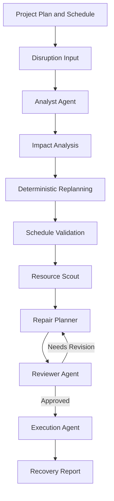

# Waymark

### Multi-Agent Project Disruption Analysis and Recovery System

**Waymark helps project teams recover from unexpected disruptions by analyzing their impact, generating revised schedules, evaluating recovery strategies, and coordinating execution through specialized AI agents.**

A delay shouldn't mean starting over. Waymark turns disruption into a structured recovery process.

---

## Overview

Projects rarely follow their original plans perfectly.

A delayed task, unavailable resource, or unexpected dependency can affect multiple activities, shift deadlines, and force teams to reconsider their priorities.

Traditional project management tools help track these changes—but determining what to do next often requires significant manual effort.

**Waymark approaches this problem through coordinated AI agents and deterministic scheduling logic.**

Instead of relying on a single AI response, Waymark separates disruption recovery into distinct stages. Each stage has a defined responsibility, and proposed recovery strategies are reviewed before execution.

The result is a structured workflow that helps users understand:

- What was disrupted?
- Which tasks are affected?
- How does the disruption change the schedule?
- What recovery strategies are available?
- Which strategy should be considered?
- What actions can help the project move forward?

---

## The Problem

Projects are interconnected systems of tasks, dependencies, deadlines, and resources.

When one activity is disrupted, its consequences can propagate through the entire project. A delay in one task may affect several downstream activities, potentially pushing the project beyond its intended deadline.

The challenge isn't simply moving dates.

A useful recovery process must:

- Understand task dependencies.
- Identify downstream impact.
- Preserve unaffected work.
- Respect scheduling constraints.
- Evaluate possible recovery strategies.
- Communicate the revised plan clearly.

Waymark addresses these challenges through an orchestrated disruption recovery workflow.

---

## How Waymark Works

Waymark follows a structured pipeline from disruption input to recovery execution.



### 1. Disruption Analysis

The Analyst Agent interprets the disruption and identifies the affected task.

Waymark then analyzes task dependencies to determine which activities may be impacted.

### 2. Impact Assessment

The system examines the relationship between tasks and determines how the disruption propagates through the project.

This helps distinguish directly affected tasks from downstream tasks and unaffected work.

### 3. Deterministic Replanning

The schedule is recalculated using deterministic scheduling logic rather than relying on an LLM to invent dates.

This provides a consistent foundation for the revised schedule.

### 4. Resource Discovery

The Resource Scout searches for potentially useful alternatives and resources that may help mitigate the disruption.

These results are presented as **candidates for consideration**. Search results do not automatically establish real-world availability, confirmed pricing, or booking status.

### 5. Recovery Strategy Generation

The Repair Planner Agent proposes strategies for recovering from the disruption.

Strategies may involve accepting a revised timeline, considering alternatives, or exploring ways to reduce downstream delays.

### 6. Strategy Review

The Reviewer Agent evaluates the proposed recovery strategy against the project context and validation requirements.

If the strategy requires revision, it can be sent back to the Repair Planner for another attempt.

### 7. Execution and Reporting

Once a strategy is approved, the Execution Agent prepares the recovery output.

Waymark generates a structured recovery report containing relevant project information, the disruption analysis, recovery strategy, and schedule comparison.

---

## Multi-Agent Architecture

Waymark uses specialized agents instead of assigning the entire problem to one general-purpose AI.

| Agent | Responsibility |
|---|---|
| **Analyst Agent** | Understands the disruption and identifies relevant impact |
| **Resource Scout** | Searches for alternative resources and potential mitigation options |
| **Repair Planner** | Proposes recovery strategies |
| **Reviewer Agent** | Evaluates strategies and requests revisions when necessary |
| **Execution Agent** | Produces the approved recovery output |

Each agent operates within a defined responsibility.

The workflow is coordinated using **LangGraph**, allowing the system to manage execution, state, transitions, and review cycles.

AI agents handle interpretation and strategy generation, while deterministic logic handles critical scheduling operations and validation.

This separation helps make the recovery process more structured and reliable.

---

## Why Hybrid AI and Deterministic Logic?

Waymark deliberately separates AI reasoning from operations that require
consistent and predictable results.

| Responsibility | Approach |
|---|---|
| Disruption interpretation | AI |
| Recovery strategy generation | AI |
| Resource discovery | AI-assisted search |
| Dependency analysis | Deterministic logic |
| Schedule recalculation | Deterministic logic |
| Schedule validation | Deterministic logic |
| Strategy review | AI-assisted review with validation |

This hybrid architecture reduces reliance on LLMs for calculations and
constraint-sensitive operations while preserving their strengths in
reasoning, interpretation, and planning.

---

## Key Features

- **Dependency-aware impact analysis** — Understand how disruptions propagate through connected tasks.
- **Automated schedule recalculation** — Generate revised schedules using deterministic logic.
- **Multi-agent recovery planning** — Separate analysis, planning, review, and execution responsibilities.
- **Resource discovery** — Search for possible alternatives and mitigation resources.
- **Strategy review and revision** — Evaluate recovery proposals before execution.
- **Schedule comparison** — Understand the difference between the original and revised timelines.
- **Recovery report generation** — Produce a structured report for communicating recovery decisions.
- **Execution artifacts** — Generate supporting recovery documentation and stakeholder communication materials.
- **Interactive interface** — Configure projects, introduce disruptions, and inspect recovery results through Streamlit.

---

## Project Structure

```text
waymark/
├── .streamlit/
│   └── config.toml
│
├── artifacts/
│   ├── execution_checklist.md
│   ├── recovery_report.pdf
│   └── stakeholder_communications.md
│
├── frontend/
│   └── app.py
│
├── scripts/
│   ├── benchmark_models.py
│   ├── test_analyst.py
│   ├── test_execution.py
│   ├── test_gemini.py
│   ├── test_repair_planner.py
│   ├── test_resource_scout.py
│   ├── test_reviewer.py
│   └── test_serpapi.py
│
├── src/
│   └── waymark/
│       ├── agents/
│       │   ├── analyst.py
│       │   ├── execution.py
│       │   ├── repair_planner.py
│       │   ├── resource_scout.py
│       │   └── reviewer.py
│       │
│       ├── artifacts/
│       │   ├── execution_artifacts.py
│       │   └── recovery_report.py
│       │
│       ├── disruptions/
│       │   └── impact.py
│       │
│       ├── graph/
│       │   └── dependencies.py
│       │
│       ├── llm/
│       │   ├── benchmark.py
│       │   ├── gemini_client.py
│       │   └── serpapi_client.py
│       │
│       ├── orchestration/
│       │   ├── graph.py
│       │   ├── nodes.py
│       │   └── state.py
│       │
│       ├── scheduling/
│       │   ├── comparison.py
│       │   ├── replanner.py
│       │   └── scheduler.py
│       │
│       ├── schemas/
│       │   ├── analysis.py
│       │   ├── disruption.py
│       │   ├── execution.py
│       │   ├── plan.py
│       │   ├── recovery.py
│       │   ├── resource_scout.py
│       │   ├── review.py
│       │   ├── schedule.py
│       │   ├── schedule_comparison.py
│       │   ├── task.py
│       │   └── validators.py
│       │
│       ├── validation/
│       │   └── schedule_validator.py
│       │
│       ├── config.py
│       └── __init__.py
│
├── tests/
│   ├── integration/
│   │   ├── test_disruption_workflow.py
│   │   └── test_orchestration.py
│   │
│   └── unit/
│       ├── agents/
│       │   └── test_execution.py
│       ├── disruptions/
│       │   └── test_impact.py
│       ├── graph/
│       │   └── test_dependencies.py
│       ├── scheduling/
│       │   ├── test_replanner.py
│       │   ├── test_scheduler.py
│       │   └── test_schedule_comparison.py
│       ├── schemas/
│       │   ├── test_disruption.py
│       │   ├── test_plan.py
│       │   ├── test_schedule.py
│       │   └── test_task.py
│       └── validation/
│           └── test_schedule_validator.py
│
├── pyproject.toml
├── uv.lock
├── README.md
└── .gitignore
```

### Core Modules

| Module | Responsibility |
|---|---|
| `agents/` | Specialized AI agents for analysis, planning, resource discovery, review, and execution |
| `disruptions/` | Disruption impact analysis |
| `graph/` | Project dependency graph construction and analysis |
| `llm/` | Gemini integration, SerpApi integration, and model benchmarking |
| `orchestration/` | LangGraph workflow definition, nodes, and shared state |
| `scheduling/` | Schedule generation, replanning, and schedule comparison |
| `schemas/` | Pydantic models and data validation schemas |
| `validation/` | Schedule validation and constraint checking |
| `artifacts/` | Generation of recovery reports and execution artifacts |
| `frontend/` | Streamlit user interface |
| `tests/` | Unit and integration tests |
| `scripts/` | Development, model benchmarking, and standalone testing utilities |

---

## Getting Started

### Prerequisites

Make sure you have the following installed:

- Python 3.13+
- [uv](https://docs.astral.sh/uv/)
- Git

You will also need API credentials for the services configured in your environment.

### 1. Clone the repository

```bash
git clone https://github.com/yuvraj-9999/waymark.git
cd waymark
```

### 2. Install dependencies

```bash
uv sync
```

### 3. Configure environment variables

Create a `.env` file in the project root using the environment variables expected by the application.

Example:

```env
GEMINI_API_KEY=your_gemini_api_key
SERPAPI_API_KEY=your_serpapi_api_key
```

Keep your API keys private. Never commit your `.env` file.

### 4. Run Waymark

```bash
uv run streamlit run frontend/app.py
```

Streamlit will provide a local URL to open the application in your browser.

---

## Running Tests

Waymark includes automated tests for validating its scheduling and recovery logic.

Run the test suite:

```bash
uv run pytest
```

Run Ruff checks:

```bash
uv run ruff check .
```

Automatically apply supported Ruff fixes:

```bash
uv run ruff check . --fix
```

---

## Design Principles

### Deterministic scheduling, AI-assisted decisions

Scheduling dates and dependency constraints should not depend on an LLM's ability to perform arithmetic consistently.

Waymark uses deterministic logic for schedule calculations and validation while using AI for tasks that benefit from interpretation, research, and strategic reasoning.

### Specialized responsibilities

Each agent has a focused role. This makes the workflow easier to understand, test, and extend.

### Review before execution

Recovery strategies are reviewed before being passed to the execution stage.

### Preserve unaffected work

A disruption should not unnecessarily invalidate tasks that remain feasible.

### Human-readable recovery

A recovery plan should be understandable to the person managing the project—not just to the agents that generated it.

---

## Limitations

Waymark is a prototype demonstrating AI-assisted project disruption recovery.

- Resource discovery results require independent verification before real-world use.
- Recovery strategies are recommendations, not guaranteed optimal solutions.
- Real-world scheduling may require additional constraints such as calendars, working hours, resource capacity, and task-specific rules.
- API availability and model response reliability depend on external providers.

---

## Future Improvements

Potential future enhancements include:

- Email drafting and recovery notifications
- Resource availability verification
- More advanced resource-constrained scheduling
- Additional disruption types
- Interactive schedule visualization
- Human approval and execution tracking
- Integration with external project management platforms

---

## Built With

- Python
- LangGraph
- Pydantic
- NetworkX
- Streamlit
- Gemini API
- SerpApi
- ReportLab
- pytest
- Ruff

---

## Author

**Yuvraj Sabale**

B.Tech Computer Engineering

[GitHub](https://github.com/yuvraj-9999)

---

## License

This project is currently intended for educational, demonstration, and portfolio purposes.

---

<p align="center">
  <strong>Waymark — When plans change, find the way forward.</strong>
</p>
